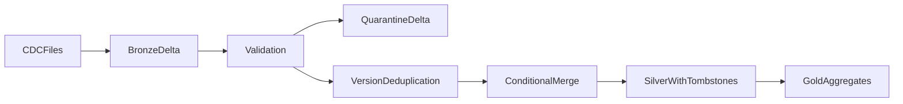

# Architecture and review guide

## Execution boundaries

A real PySpark/Delta job writes bronze and quarantine tables, detects conflicting versions, uses a window to select source updates, performs a conditional Delta MERGE into silver, and publishes regional gold aggregates. Durable tombstones preserve source versions and prevent stale CDC updates from resurrecting deleted orders. A separate reference implementation defines the merge contract and enables quick deterministic regression tests.

## Decisions to review

Spark dependencies are separate because they require Java and download Delta JARs. Local reference tests do not prove Spark runtime execution. Bronze and quarantine are append-only delivery logs and can contain replay duplicates; silver is idempotent by source key/version. Tables commit independently, so recovery replays a retained batch to finish gold publication. This bounded job is designed for batch CDC, not an implemented streaming connector.

## Failure exercise

1. Run the supplied synthetic example and record its state or output.
2. Run the same input again. Inspect the replay policy: event/batch idempotency for transactional systems, stable latest-state results for CDC, pinned versions for contracts, and explicit output prefixes for Beam.
3. Introduce a malformed input and run the tests that exercise rejection. Check whether the contract requires quarantine or whole-batch failure before re-running.
4. Stop the persistence service during a write when using a deployed topology. Confirm that the consumer/scheduler does not advance its source checkpoint before the sink commits.
5. Recover from the retained input. Inspect receipts, rejects, run metadata, or comparison reports instead of assuming a successful process exit implies end-to-end correctness.

Steps requiring Kafka, PostgreSQL, Airflow, Spark, or containers are deployment exercises, not claims that those environments were tested here. See `VALIDATION.md` for executed evidence.

## Portfolio discussion

Be prepared to explain the input grain, key/version contract, transaction boundary, retained state, failure recovery, and the changes required for multiple workers or a cloud deployment. The implementation deliberately exposes these decisions rather than claiming scale from a small synthetic example.
